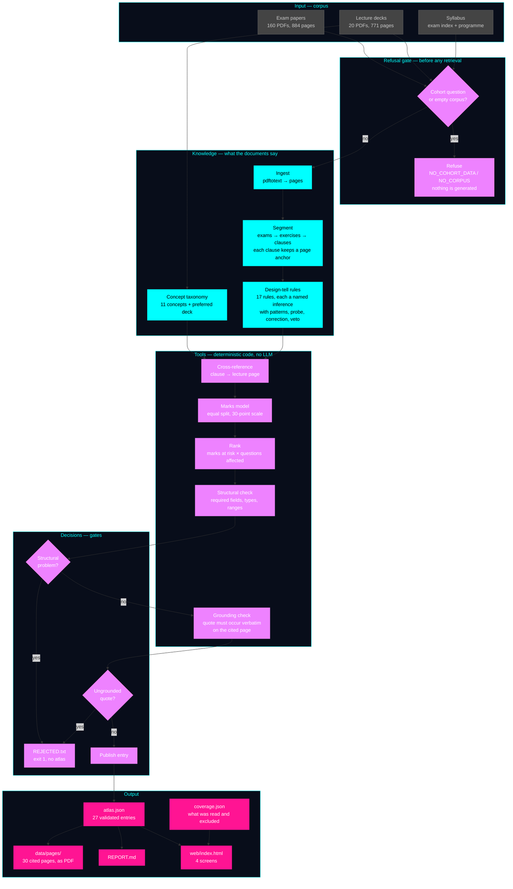

# Failure-Mode Atlas

**A ranked, evidence-linked map of what one professor's exams are built to catch — and a detector that refuses to say anything the documents don't support.**

Built for Student Tech Clash 2026, case study *AI on Campus* (Direction 1: Teaching).

**Team:** Zeyad Kandil · Maxime Kerger · Berk Ateşlap · Angelica Corbalán

Course: **Robotics 1**, Sapienza University of Rome, Prof. Alessandro De Luca.
Corpus source: `http://www.diag.uniroma1.it/deluca/rob1_en.php` (recorded in the course syllabus PDF itself, p. 1).

---

## The claim

A professor's exam encodes an implicit theory of student error. Some of that theory leaks into the wording: an instruction that only makes sense if a specific mistake is expected is *documented* evidence that the mistake is expected.

> "…assign the Denavit-Hartenberg (D-H) convention, **so that all constant D-H parameters are non-negative**."

That clause is not neutral. It exists because students choose frame conventions that make parameters negative. The clause is quotable; the inference from clause to student behaviour is named, numbered and auditable — it is rule `DT-01` in [`atlas/rules.py`](atlas/rules.py), not a hidden leap inside a model.

So the product is narrow on purpose:

* **Find** the failure modes the exams pre-empt.
* **Rank** them by marks exposed × questions affected.
* **Prove** each one with a verbatim quote from a page anyone can open.

It does **not** predict what students did. There is no cohort data in this corpus, and the system says so — in code, twice, before retrieval runs.

---

## Quick start

Requires Python 3.11+ and [poppler](https://poppler.freedesktop.org/) (`pdftotext`, `pdfinfo`). No Python packages are needed.

```bash
cd failure-mode-atlas

# 1. corpus -> validated atlas (writes data/*.json, refuses on any ungrounded claim)
python -m atlas.cli build

# 2. ask it something
python -m atlas.cli ask "Why do students get DH frame signs wrong?"

# 3. human report + viewer
python -m atlas.report          # -> data/REPORT.md
python -m atlas.view            # -> web/index.html

# 4. reproduce the self-validation draw
python -m atlas.cli spotcheck --sample 8 --seed 11

# 5. tests
python -m unittest discover -s tests -v
```

### Opening the viewer

Three ways, in order of convenience:

```bash
./demo.sh                       # http://localhost:8787/  (serves the repo, opens a browser)
```

```bash
xdg-open web/index.html         # or: open web/index.html   (macOS)
```

or just **double-click `web/index.html`** in a file manager. The file is self-contained — data inlined, no fetch, no build step, works from `file://`. A copy of that one file is enough to show on another machine.

**If it does not open, it is almost always one of these:**

| Symptom | Cause | Fix |
|---|---|---|
| You see HTML source text | You clicked `web/index.html` **on github.com**. GitHub serves repository files as text and never renders HTML. | Clone the repo and open the file locally, or run `./demo.sh` |
| Nothing happens on double-click | No default application for `.html` | `xdg-open web/index.html`, or `./demo.sh` |
| Blank page or unstyled text | The file was truncated while copying | Re-copy the whole 166 KB file, or `python -m atlas.view` to regenerate |
| Page loads but links do nothing | You are looking at an old build | `python -m atlas.view` rewrites it |
| Works locally, not over SSH | `file://` paths and `localhost` refer to the remote machine | Copy `web/index.html` to your machine and open that single file |

The viewer is verified interactively, not just visually: in headless Chromium a scripted click on row 1 routes to `#/mode/…` and renders the detail screen, the evidence link opens `#/evidence/…` with the quote highlighted, and the coverage screen's grounding checker returns `NOT FOUND` when a word is added to a quote.

The corpus itself is **not** committed (210 MB of third-party PDFs). `data/` contains everything needed to inspect the result, including the extracted text of every cited page — and `data/pages/` holds those **30 cited pages as one-page PDFs**, so any quote can be checked against the rendered page without the original download. See [`corpus/README.md`](corpus/README.md) to re-fetch the full set.

### The screens

| Screen | Route | What it answers |
|---|---|---|
| Atlas index | `#/` | What are the modes, and in what order? |
| Failure-mode detail | `#/mode/<id>` | What exactly goes wrong, and where is it proven? |
| Evidence viewer | `#/evidence/<id>/exam` | Show me the quote on the page it claims to come from. |
| **Ask** | `#/ask` | Ask a question and get the matching entries back — or a refusal. |
| Coverage | `#/coverage` | What was read, what was refused, what is modelled? |

The **Ask** screen is retrieval over the 27 validated entries, not generation. It is also where both refusals are visible without a terminal:

- *"What will students score on question 3?"* → `NO_COHORT_DATA` card. The guard runs before retrieval, so the question never reaches the atlas.
- *"What is the capital of Peru?"* → *"No match in the atlas"* rather than the nearest entry dressed up as an answer.

The guard is not re-implemented in JavaScript. `atlas/answer.py` owns `COHORT_PATTERNS`, `NO_COHORT_REASON`, `STOP` and `ranked_matches`; the viewer inlines that data at build time and `tests/test_atlas.py::TestAnswerParity` asserts that the parsed JSON block in `web/index.html` equals the Python source. The CLI and the browser cannot drift apart without a test failing.

The coverage screen includes a **"Try to break it"** panel: edit a quote in the browser and check it against the page. It runs the same containment test the build runs. Delete a word and it reports `NOT FOUND` — the build would have written `REJECTED.txt` instead of that entry.

All four screens the brief asks for are present. **Ask** is the fifth, and it is the one to open first when demoing, because it makes the refusal behaviour visible in five seconds.

---

## Architecture



**Legend.** Cyan = knowledge and transformation modules. Magenta = tools and gates that decide. Pink = stored artefacts. Grey = external corpus. Dark subgraph headers = pipeline stages.

### Input → knowledge → tools → decisions → output, in words

* **Input** is one course only: exam papers, the decks they cross-reference, and the syllabus. No multi-course support, by design.
* **Knowledge** is built in three steps. Ingest turns PDFs into page text. Segment turns an exam into exercises and each exercise into task clauses, keeping the page each clause starts on. Rules name the inferences. Everything after this step is counting and citing.
* **Tools** do not generate language. `evidence.py` verifies, `build.py` measures and ranks, and neither calls a model.
* **Decisions** are gates with no human in the loop. A claim either grounds or the build refuses wholesale. A question either has cohort data behind it or it is refused before retrieval.
* **Output** is JSON, Markdown and one self-contained HTML file, all derived from the same validated list.

### Pipeline detail

| Stage | File | What it decides |
|---|---|---|
| Ingest | `atlas/ingest.py` | A page with <80 chars is *scanned*; no claim is ever made from it. |
| Segment | `atlas/segment.py` | `Exercise N` / `Question #N` headings; solutions cut off at `Solution of Midterm Test`, `Soluzioni`, `Svolgimento`; clauses split on lettered/roman/bullet markers, else on task-verb sentences. |
| Rules | `atlas/rules.py` | 17 design tells. Each has a regex, the trigger, the wrong turn, the misconception, a probe, a correction, and optionally a `veto`. |
| Evidence | `atlas/evidence.py` | Structural + grounding validators, plus first-class `Refusal` objects. |
| Build | `atlas/build.py` | Fires rules over clauses, picks the tightest quote, cross-references the lecture page, models marks, ranks, and gates the write. |
| Report | `atlas/report.py` | Markdown, including the self-validation table. |
| View | `atlas/view.py` | Four hash-routed screens, data inlined. |

---

## How one failure mode is made

1. **A rule fires.** `DT-11` matches *"in minimum time"* under velocity/acceleration bounds.
2. **A quote is cut.** The sentence window is tightened around the trigger, then trimmed of leading noise. The quote must contain the firing span, be ≥2 words and ≥12 characters, and look like prose (no equations, URLs, or bullet debris).
3. **The exam is counted.** One occurrence per clause, deduplicated per exam.
4. **The lecture page is found.** The concept's preferred deck is searched; the earliest page within 10% of peak keyword density wins ("where it is first taught").
5. **Marks are modelled.** 30 marks split equally across exercises, then across clauses. `marks_at_risk` is the mean exposure *per exam in which the mode appears*.
6. **Ranking.** `score = marks_at_risk × questions_affected`. The report shows the product, so the ordering is legible rather than asserted.
7. **The gate.** Structural pass, then grounding pass. Both, or nothing.

---

## The guardrail is code, not prompt

```
$ python -m atlas.cli build
wrote data/atlas.json: 27 failure modes, 97/160 exams analysed, 351 questions parsed,
0 quote(s) rejected by grounding.
```

There are two validators because there are two distinct ways to be wrong:

| Validator | Question it asks | Why schema alone is not enough |
|---|---|---|
| **Structural** | Are all required fields present, typed, and in range? | A schema validator happily passes a beautifully formatted, entirely invented quote. |
| **Grounding** | Does the quote occur verbatim on the cited page, after whitespace normalisation? | This is the check that makes the atlas inspectable. |

`build.write()` runs both. Any problem and it writes `REJECTED.txt` with the offending claims and exits `1` — **it does not write a shorter atlas**. A missing entry is a gap; a made-up entry is a lie, and the two must not look the same.

Matching is done on a whitespace-flattened, case-folded form of both quote and page, because PDF extraction inserts line breaks and soft hyphens a human reader never sees.

### Verify a claim in thirty seconds, without the corpus

1. Open any entry, click **Open the page as PDF** — that is the cited page extracted from the source file, one page, full fidelity.
2. Read the quote from the entry against the page. It is there, verbatim, or the entry would not exist.
3. Click **back to the mode** to see the inference built on top of it.

`data/pages/` holds exactly the 30 pages the atlas cites, nothing else. The check does not depend on the text layer at all: the rendered page is the ground truth.

---

## Example interactions

### 1. A normal question — retrieval, not generation

```
$ python -m atlas.cli ask "Why do students get DH frame signs wrong?"

3 match(es) in the atlas, ranked by marks at risk:

## Sign gauge pre-empted — DH frame assignment  [FM-DT-01-dh_frames]
   marks at risk 2.9/30 per affected exam · 16 questions · 15 exams · documented · confidence 0.95
   trigger : The task constrains the sign of the DH parameters before the student starts.
   what goes wrong: Assigns z-axes in the opposite direction, so d or a come out negative,
                    then flips a sign somewhere downstream to compensate.
   why: DH parameters are whatever the diagram shows; the convention is decoration rather
        than a gauge choice you must declare.
   exam evidence: Robotics1_24.02.16 (Exercise 2a, p. 2)
     "Denavit-Hartenberg (D-H) convention, so that all constant D-H parameters are non-negative. …"
   taught in: 09_DirectKinematics (p. 12)
   probe: For this arm, which DH entries can be made nonnegative, and which axis direction
          did you have to reverse to do it?
   correction: Fix the z-axis direction rule first, then read the table off. …
```

`ask` ranks by keyword overlap over the validated entries. It never writes new prose — every line above is a field copied out of `atlas.json`.

### 2. Refusal — no cohort data (exit 0)

```
$ python -m atlas.cli ask "What will students score on question 3?"

REFUSED (NO_COHORT_DATA)

What will students score on question 3?

No cohort data is present in this corpus. The exams contain questions and solutions;
they contain no student responses, no marks distribution and no statistics.
Any predicted score would be invented, so none is given.
```

The pattern is matched *before* retrieval, so a persuasive question cannot argue its way past it. Exit code `0`: refusing is a successful answer, not an error.

### 3. Refusal — no corpus (exit 2)

```
$ python -m atlas.cli ask "Give me the failure modes for this course" --corpus /tmp/empty_course

REFUSED (NO_CORPUS)

No readable course material was found at '/tmp/empty_course'. The atlas is built only
from documents it can cite, so with an empty corpus there is nothing to report.
```

An atlas of guesses is exactly what this project exists to avoid.

### 4. The guardrail, attacked by hand

The viewer's coverage screen has a live grounding panel. Select any entry, delete three words from the quote, press *Check against the page*:

```
NOT FOUND. The build would refuse this quote — it writes REJECTED.txt and no atlas entry.
```

Restore the text and it reports `FOUND on <doc>, <ref>`. This is the same `normalise()` containment test used at build time, running on text the visitor controls.

### 5. Regression that mattered

An early cohort guard included a bare `get` pattern, so the question *"Why do students **get** DH frame signs wrong?"* was refused as a score prediction. The guard now requires an actual score/outcome object. The case is pinned in the test suite:

```python
def test_regression_bare_get_is_not_a_score_request(self):
    self.assertFalse(self.wants("Why do students get DH frame signs wrong?"))
```

---

## Demo script (5 minutes)

| Time | Do | Say |
|---|---|---|
| 0:00 | `./demo.sh` → `http://localhost:8787/` | "27 failure modes. Most are an instruction in a past paper that only makes sense if a specific error is anticipated; two are labelled reconstructed because the link is our inference, not the wording." |
| 0:40 | Click row 1 | "Score 232: 7.74 marks per affected exam, across 30 questions in 18 exams." |
| 1:00 | Click *Open the page as PDF* | "This is the cited page, extracted from the original file, one page. The quote is on it. Check me." |
| 1:40 | Coverage → *Try to break it*, delete words | "It says NOT FOUND. The build refuses to publish that entry rather than publish it weakly." |
| 2:30 | Ask → *"What will students score on question 3?"* | "Refused, in the browser, before retrieval. There is no cohort data, and the code knows that before it looks at a single entry." |
| 3:00 | Terminal: `ask … --corpus /tmp/empty_course` | "Refused again — no citable document, no atlas. The empty-corpus path is a build-time one, so it stays in the terminal." |
| 3:30 | Open `atlas/rules.py` | "Two entries are `reconstructed`, not `documented`. Here is the rule that made the inference. Attack the rule, not a hidden leap." |
| 4:20 | `data/REPORT.md` §9 | "Eight random entries re-read by hand. Eight confirmed. One real defect was found and fixed before this draw — and the pre-fix number is still in the report." |

---

## Self-validation

**Sample size: 8 failure modes**, drawn with `spotcheck --sample 8 --seed 11` (reproducible), each checked by opening the cited PDF page and reading the surrounding exercise — not by re-running the substring test.

* **8/8 supported** · error rate **0.0%**
* **6/8 distinct quoted instruments.** Two entries read the same sentence for different tells, so the independent sample is smaller than the mode count. Disclosed in the report rather than hidden.

**A real defect was found and fixed before the published draw.** The first pass (seed 7) sampled an entry citing *"count the motor revolutions needed to cover the entire joint range"* as evidence of joint-limit/workspace error. That is an encoder-sizing question. Rule `DT-13`'s pattern (`joint range`) was too broad, so it gained an explicit veto for encoder/resolution/gear-ratio contexts. That veto rejects 1 clause in the corpus, and the count is published as `clauses_vetoed_by_rule_precision` in `coverage.json`. The pre-fix draw was 7/8.

Verdicts and notes live in [`data/spotcheck_verdicts.json`](data/spotcheck_verdicts.json) and `data/REPORT.md` §9.

---

## Documented vs reconstructed

| Strength | Meaning | Entries |
|---|---|---|
| `documented` | The exam wording itself pre-empts the error. The quote is the evidence. | 25 |
| `reconstructed` | The exam states the task; the link from task to student behaviour is the rule's inference, and is named as such. | 2 |

The atlas never presents the second as the first. Student behaviour is always inference — this corpus contains no student work. What is *documented* is the professor's anticipation of it, and that is what the quotes show.

---

## Coverage — the edges, counted

| | Count |
|---|---|
| Exam papers on disk | 160 (884 pages, 99.4% readable) |
| Lecture decks | 20 (771 pages, 99.4% readable) |
| Exams analysed | 97 |
| Excluded — single-block era (pre-2013, no per-question units) | 27 |
| Excluded — partial sheet / answer key | 34 |
| Excluded — no text layer | 2 |
| Task clauses parsed | 351 (85.2% of estimated total) |
| Concepts mapped to a lecture page | 11/11 |
| Quotes rejected by grounding | 0 |
| Clauses dropped by rule precision | 1 |
| OCR run | none — nothing is claimed from image-only pages |

Only exams that segment into ≥2 exercises are analysable; a single undivided block has no per-question units to rank. Exclusions are categorised and reported rather than silently dropped.

### The marks model

30 marks per exam, split equally across exercises, then across task clauses. `marks_at_risk` is the mean exposure **per exam in which the mode appears**; `marks_per_exam_all` (always smaller) is also published for context.

This split is an **assumption**. Its one documented anchor: 7 midterms state per-exercise points, and they all sum to 30. The split stays modelled and is labelled `basis: "reconstructed"` everywhere it appears.

---

## Models, libraries, custom logic

**Models: none.** There is no LLM call anywhere in the pipeline. Three reasons, all deliberate:

1. **Reproducibility** — the same corpus yields byte-identical output.
2. **No hallucinated quotes** — an LLM asked to cite a page will sometimes cite a page that does not say that.
3. **Auditability** — the intellectual content is 17 readable rules and a counting loop, not a prompt.

**Libraries:** Python standard library only (`re`, `json`, `dataclasses`, `argparse`, `subprocess`, `unittest`). External binaries: `pdftotext` and `pdfinfo` from poppler.

**Custom logic that carries the product:**

* `normalise()` / `flatten()` — whitespace-collapsed, case-folded matching so a quote spanning a PDF line break still verifies.
* Tightest-quote search — a quote must contain the span that made the rule fire, so evidence cannot drift away from the claim.
* `Rule.veto` — precision knob; vetoed clauses are counted, not hidden.
* Preferred-deck routing with per-concept `avoid` terms, and "first taught" page selection.
* Equal-split marks model with explicit `basis`.
* First-class `Refusal` objects returned from code paths that run before retrieval.

**Not used:** `pdfplumber`, `pypdf`, `pymupdf`, any embedding store, any vector database, any hosted model.

---

## Limitations

* **No cohort data.** Nothing here says what students did. It says what the papers are built to catch.
* **Marks are modelled, not measured.** Ranking is exposure under an equal split.
* **Rules are a reading.** 17 tells, each quotable, but another examiner could read the same clause differently. That is why rules are named and separable.
* **Entries are not independent.** One sentence can pre-empt several errors; the evidence screen names the other entries sharing a page.
* **Extraction artefacts.** Inline maths is mangled by PDF extraction (`ℱ`, `𝑅𝐹`, `kq̇k`), so quotes are prose spans and equations are never used as evidence.
* **One course, by design.** No cross-course comparison and no platform.
* **No OCR.** 5 image-only pages per corpus are excluded and counted; nothing is claimed from them.
* **No claim of learning impact.** This is a structural finding with counts, not evidence that using it improves a mark.

---

## Repository layout

```
atlas/
  ingest.py     PDF -> pages, with scanned-page detection
  segment.py    pages -> exercises -> clauses, each with a page anchor
  rules.py      17 design-tell rules + 11-concept taxonomy  (the intellectual content)
  evidence.py   structural + grounding validators, Refusal
  build.py      orchestration, marks model, ranking, the write gate
  answer.py     the refusal guard + retrieval, shared by CLI and browser
  report.py     Markdown report, incl. self-validation table
  view.py       5-screen self-contained viewer
  cli.py        build / ask / spotcheck
data/
  atlas.json            27 validated entries
  coverage.json         what was read, excluded, modelled
  evidence_pages.json   extracted text of every cited page (viewer input)
  pages/                30 one-page PDFs of the cited pages, so every quote is checkable
  REPORT.md             human-readable report
  spotcheck_sample.json the reproducible draw
  spotcheck_verdicts.json  manual verdicts with notes
web/index.html          generated viewer (open from disk, or `./demo.sh`)
demo.sh                 serve the repo on localhost and open a browser
index.html              redirect to web/index.html (only needed when served)
tests/test_atlas.py     44 tests, stdlib unittest
corpus/                 not committed; see corpus/README.md
```

## Tests

```bash
python -m unittest discover -s tests -v     # 44 tests
```

They cover the parts that must not silently break: normalisation and quote spanning, grounding rejection of a fabricated quote, the write gate producing `REJECTED.txt` and no `atlas.json`, structural validation, page-anchor labels, segmenter heading variants and solution headers, the `DT-13` veto, the cohort-refusal regression, viewer placeholder replacement and `</script>` escaping, parity between the CLI guard and the guard inlined in `web/index.html` (the JSON block is parsed, not grepped), and a check that the published atlas is structurally valid and still in rank order.
